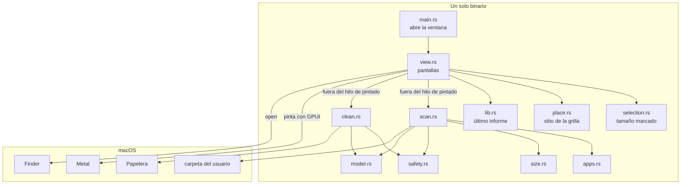

# Cristal

Limpieza clara para tu Mac. Cristal analiza la carpeta de tu usuario, te muestra qué se puede liberar y solo mueve a la Papelera lo que confirmas.

La ventana es GPUI, sin vidrio, según [PLAN-0012](docs/plans/PLAN-0012-migrar-vista-a-gpui.md). No usa `NSGlassEffectView` y no cumple [REQ-0003](docs/requirements/baseline.md). `cargo run` dentro de `src-tauri` abre esa ventana. El Dock muestra un cristal plano de la paleta de día lluvioso, según [PLAN-0021](docs/plans/PLAN-0021-icono-de-cristal.md). No es la gota de Tauri ni es vidrio.

La 0.2.2 para Apple Silicon está en [v0.2.2](https://github.com/zknchile/LimpiarMyMac/releases/tag/v0.2.2). El disco no está firmado con un certificado de Apple ni notarizado. No hay binario para Mac Intel.

## Qué limpia

| Categoría | Qué incluye | Marcada por defecto |
| --- | --- | --- |
| Navegadores | Caché y archivos temporales de Chrome, Safari, Firefox, Edge, Brave y otros. Opcionalmente, cookies. | Solo la caché grande |
| Cachés de apps | `~/Library/Caches`. Las apps pueden volver a crearlos. | Si pesan más de 512 KB |
| Restos de apps | Carpetas, preferencias y agentes de apps que ya no están instaladas. | No |
| Registros | Logs de `~/Library/Logs`. | Sí, excepto informes de fallos |
| Desarrollo | Xcode, Homebrew, npm, pip, Cargo y similares. | No |
| Instaladores | `.dmg` y `.pkg` en Descargas con más de 30 días. | No |
| Papelera | Vaciar lo que ya tiraste. Esta acción es permanente. | No |

No toca Documentos, Fotos, el Escritorio, el Llavero, contraseñas, marcadores ni el historial. Tampoco borra datos de Apple (`com.apple.*`) fuera de cachés y registros. Un archivo `com.apple…` que vive dentro del contenedor de otra app sí se puede mover: es una copia de esa app, no Mail ni las preferencias del sistema.

Los restos de una app no se mandan enteros a Finder. Si el contenedor tiene enlaces al Escritorio, a Descargas o al Llavero, se mueven los archivos reales y solo se quita el enlace. macOS puede dejar un registro interno (`.com.apple.containermanagerd.metadata.plist`); no se cuenta como fallo ni como espacio recuperable.

Los elementos marcados como **Revisar** pueden incluir documentos. Ábrelos con **Ver** antes de limpiarlos.

## Cómo usarla

1. Pulsa **Analizar esta Mac**. Todavía no se borra nada.
2. Revisa la selección. Lo seguro ya viene marcado. El tamaño cambia al marcar o desmarcar; si no queda nada, muestra 0 B. La barra dice cuánto hay seleccionado de lo encontrado, por ejemplo `4.2 GB de 6.1 GB`.
3. Pulsa **Revisar y limpiar** y confirma. **Cancelar** vuelve a los resultados y no mueve nada.

**Salir** cierra la app. Está siempre abajo a la derecha, a la derecha de **Analizar**.

## Requisitos

- macOS
- [Rust](https://rustup.rs) 1.85 o posterior
- Xcode, porque la ventana usa Metal

## Ejecutar en desarrollo

```bash
cd src-tauri
cargo test --lib
cargo run
```

Si el selector apunta a Command Line Tools, el build usa `DEVELOPER_DIR=/Applications/Xcode.app/Contents/Developer`. La primera compilación tarda: baja GPUI y compila Metal.

`cargo test --lib` cubre las reglas de rutas, el tamaño de la selección y el sitio de la grilla. No abre la ventana. Qué cubre cada prueba está en [casos](docs/testing/TEST-CASES.md).

## Generar el binario

```bash
cd src-tauri
cargo build --release
../scripts/package_macos.sh
```

El ejecutable queda en `src-tauri/target/release/cristal`. El script arma `Cristal.app` y el `.dmg` de la versión del crate. La 0.2.2 es [PLAN-0022](docs/plans/PLAN-0022-publicar-0.2.2.md). Esa release no está firmada con un certificado de Apple.

## Documentación

El método de trabajo sigue [Arquitectura_agent](https://github.com/zknchile/Arquitectura_agent). En este repositorio:

- [AGENTS.md](AGENTS.md) — por dónde empezar.
- [Requisitos](docs/requirements/baseline.md), [decisiones](docs/decisions/README.md), [pruebas](docs/testing/TEST-CASES.md) y [evolución](CHANGELOG.md).
- [Planes](docs/plans/PLAN-0001-documentar-desarrollo.md). El desarrollo inicial está reconstruido en [PLAN-0002](docs/plans/PLAN-0002-registro-desarrollo-cristal.md); no se escribió antes de programar. El tamaño de la selección se corrigió en [PLAN-0003](docs/plans/PLAN-0003-actualizar-tamano-seleccion.md). Los contenedores con enlaces, el registro interno de macOS y las copias `com.apple` dentro de otra app quedaron en [PLAN-0004](docs/plans/PLAN-0004-contenedor-sin-seguir-enlaces.md), [PLAN-0005](docs/plans/PLAN-0005-omitir-metadata-de-contenedor.md), [PLAN-0006](docs/plans/PLAN-0006-no-bloquear-copia-dentro-del-contenedor.md) y [PLAN-0007](docs/plans/PLAN-0007-nota-del-registro-visible.md). Salir quedó abajo a la derecha según [PLAN-0008](docs/plans/PLAN-0008-salir-junto-a-analizar.md). Las pruebas se fichan según [PLAN-0009](docs/plans/PLAN-0009-documentacion-de-pruebas.md). La grilla se queda donde se marcó según [PLAN-0010](docs/plans/PLAN-0010-grilla-sin-saltar.md). El primer diagrama está en [PLAN-0011](docs/plans/PLAN-0011-diagrama-de-componentes.md). Se actualizó al cerrar [PLAN-0012](docs/plans/PLAN-0012-migrar-vista-a-gpui.md) y quedó en un solo binario según [PLAN-0014](docs/plans/PLAN-0014-diagrama-de-la-ventana-gpui.md). La ventana es GPUI. No aplica Liquid Glass y no cumple [REQ-0003](docs/requirements/baseline.md). La 0.2.0 se publicó según [PLAN-0013](docs/plans/PLAN-0013-publicar-0.2.0.md). La 0.2.1 se publicó según [PLAN-0020](docs/plans/PLAN-0020-publicar-0.2.1.md). Los colores son la paleta de día lluvioso según [PLAN-0017](docs/plans/PLAN-0017-paleta-dia-lluvioso.md). El velo no cumple REQ-0003. Los botones tienen sombra según [PLAN-0018](docs/plans/PLAN-0018-profundidad-de-botones.md). Esa sombra tampoco cumple REQ-0003. La franja del menú es un poco más oscura según [PLAN-0019](docs/plans/PLAN-0019-franja-del-menu.md). Tampoco cumple REQ-0003. El icono es un cristal plano según [PLAN-0021](docs/plans/PLAN-0021-icono-de-cristal.md). No es vidrio ni la gota de Tauri. La 0.2.2 se publicó según [PLAN-0022](docs/plans/PLAN-0022-publicar-0.2.2.md).

## Cómo está armada

Todo corre en un solo binario. No hay HTML, ni WebKit, ni comandos `invoke`, ni servicio HTTP. La ventana y el análisis no son dos procesos. El detalle está en [ADR-0003](docs/decisions/ADR-0003-vista-gpui.md).



| Pieza | Qué hace |
| --- | --- |
| `src-tauri/src/main.rs` | Arranca GPUI y abre la ventana titulada Cristal. Si se cierra, termina el proceso. |
| `src-tauri/src/view.rs` | Pinta las pantallas, pide confirmación y cierra con Salir. El análisis y la limpieza no corren en el hilo de pintado. |
| `src-tauri/src/selection.rs` | Cuenta cuánto hay marcado. No decide si una ruta se puede borrar. |
| `src-tauri/src/place.rs` | Decide si, al redibujar, la grilla se queda donde estaba. |
| `src-tauri/src/lib.rs` | Guarda el último informe y la tarea en curso. Muestra un archivo o abre la Papelera con `open`. |
| `src-tauri/src/scan.rs` | Recorre la carpeta del usuario y propone elementos. |
| `src-tauri/src/apps.rs` | Lee qué apps están instaladas, para no tratar sus datos como restos. |
| `src-tauri/src/size.rs` | Mide el peso y la antigüedad. |
| `src-tauri/src/safety.rs` | Lista blanca. Rechaza lo que está fuera, aunque la interfaz lo pida. |
| `src-tauri/src/clean.rs` | Mueve a la Papelera solo identificadores del último análisis. |
| `src-tauri/src/model.rs` | Forma del informe que cruza la ventana y el análisis. |

GPUI pinta con Metal. Eso no es Liquid Glass: la ventana no usa `NSGlassEffectView` y no cumple [REQ-0003](docs/requirements/baseline.md).

La limpieza y el análisis usan las mismas reglas. Un archivo solo se puede mover si estaba en el último análisis y vive en una carpeta permitida.
